Algunas novedades de R y su ecosistema, para revisar en la junta del lunes 30 de noviembre.

## RStudio y Posit

::: {.noticia}
**Actualizaciones de RStudio**

<!-- 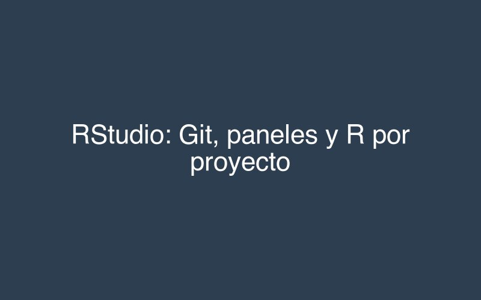{.imagen-derecha} -->

*Más Git en el editor, división de paneles y R por proyecto*

La versión de noviembre incluye algunas novedades sobre Git: el **margen del editor** marca las líneas agregadas, cambiadas o eliminadas desde el último commit, y también a **comparar versiones** del documento lado a lado, resaltando las diferencias.

Recientemente se agregó la **división del editor** (horizontal y vertical).

[Release notes](https://docs.posit.co/ide/news/) · [Positron](https://positron.posit.co/)
:::

::: {.noticia}
**rig dentro de RStudio**

{.imagen-derecha}

[RStudio](https://posit.co/products/open-source/rstudio/) ahora trae [rig](https://github.com/r-lib/rig) incorporado, que permite cambiar entre versiones de R.

Si el proyecto (por ejemplo, vía [`renv`](https://rstudio.github.io/renv/)) pide otra versión de R, avisa y ofrece cambiar, instalándola en segundo plano si falta. Si la biblioteca de renv está vacía, ofrece `renv::restore()`.

[Blog post sobre rig 0.11.0](https://opensource.posit.co/blog/2026-10-15_rig-0-11-0-part-three/) · [Repositorio de rig](https://github.com/r-lib/rig)
:::

::: {.noticia}
**Se acaba ShinyApps.io**

{.imagen-derecha}

*Migración de cuentas a Connect Cloud*

La migración automática de cuentas empieza el 28 de enero de 2027 para el plan gratuito. Hay una [herramienta de migración](https://docs.posit.co/connect-cloud/user/shinyapps-migration.html): vinculas tu cuenta, eliges las apps y las pruebas antes de finalizar. 

RStudio ya marcó [RPubs](https://rpubs.com/) y [ShinyApps.io](https://www.shinyapps.io/) como destinos de publicación obsoletos.

[Anuncio](https://posit.co/blog/migrating-connect-cloud-posits-unified-publishing-solution) · [Guía de migración](https://docs.posit.co/connect-cloud/user/shinyapps-migration.html)
:::

::: {.noticia}
**Posit AI Pass**

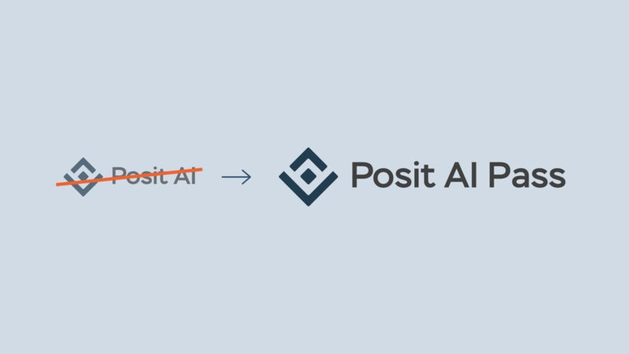{.imagen-derecha}

*El servicio de modelos se renombra para no confundirlo con Posit Assistant*

_Posit AI_ pasó a llamarse [Posit AI Pass](https://posit.co/blog/posit-ai-now-posit-ai-pass). Es un servicio que te permite usar distintos modelos de IA (como Claude y modelos de pesos abiertos como GLM 5.3 y Kimi K3) directamente en RStudio. El primer mes cuesta US$5 y luego desde US$20 al mes. 

De todas formas, Posit Assistant también funciona con tu propio proveedor de modelos, sin necesidad del Pass.

[Anuncio](https://posit.co/blog/posit-ai-now-posit-ai-pass)
:::

## Shiny

::: {.noticia}
**Actualización de Shiny**

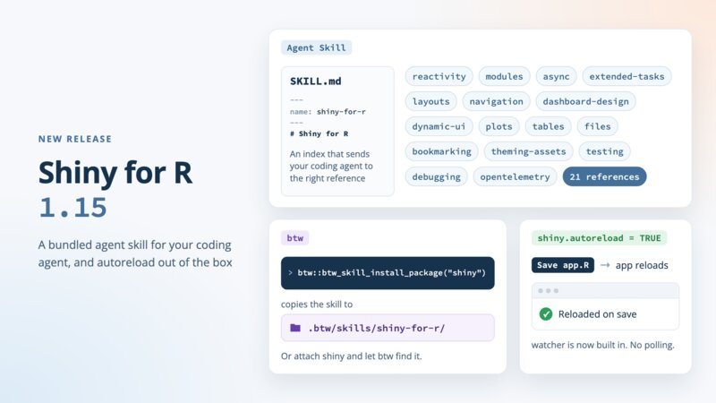{.imagen-derecha}

*Recarga automática sin polling*

[watcher 0.2.0](https://watcher.r-lib.org/) salió en [CRAN](https://cran.r-project.org/) el 29 de junio como un observador de archivos de uso general, y ahora es el nuevo motor de la **recarga automática** de [Shiny](https://shiny.posit.co/). 

Además, Shiny 1.14.0 agregó `startApp()`, que corre una app sin bloquear la sesión.

[Blog post sobre la actualización de Shiny](https://opensource.posit.co/blog/2026-11-23_shiny-r-1-15/) · [Blog post de watcher](https://opensource.posit.co/blog/2026-06-29_watcher-0-2-0/)
:::

::: {.noticia}
**shinyreact**

{.imagen-derecha}

*Interfaz React con servidor Shiny*

Permite usar componentes [React](https://react.dev/) (todo el ecosistema [npm](https://www.npmjs.com/)) con la computación reactiva de [Shiny](https://shiny.posit.co/) en el servidor, y trae skills para agentes de IA que ayudan a construir o convertir apps. Está disponible para R y Python.

[Anuncio](https://opensource.posit.co/blog/2026-09-30_introducing-shinyreact/) · [Sitio](https://posit-dev.github.io/shinyreact/) · [CRAN](https://cran.r-project.org/package=shinyreact) · [GitHub](https://github.com/posit-dev/shinyreact)
:::

::: {.noticia}
**shinychat 0.5.0**

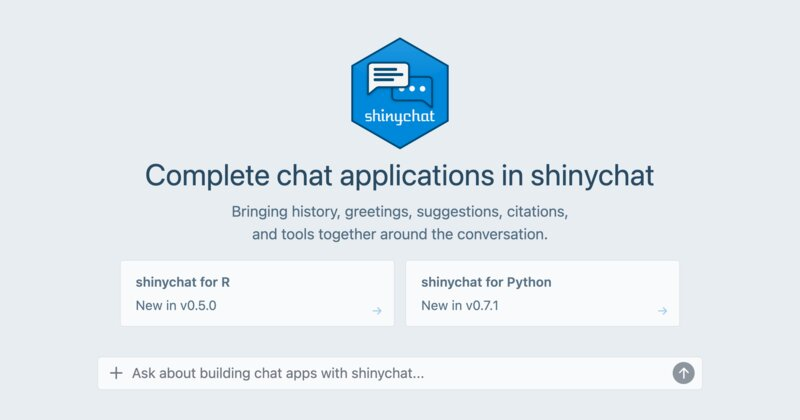{.imagen-derecha}

*Aplicaciones de chat completas en Shiny*

Trae historial de conversaciones, edición y ramificación de mensajes, adjuntos y comandos con barra, además del layout `page_chat()` de pantalla completa.

[Anuncio](https://opensource.posit.co/blog/2026-09-15_shinychat-r-0.5.0-python-0.7.1/) · [Sitio](https://posit-dev.github.io/shinychat/r/) · [CRAN](https://cran.r-project.org/package=shinychat) · [GitHub](https://github.com/posit-dev/shinychat)
:::

## Paquetes

::: {.noticia}
**mizu 0.1.0 llega a CRAN**

{.imagen-derecha}

*Paralelismo y asincronía con memoria compartida en una sola máquina*

`mizu` es un paquete de R para ejecutar tareas en paralelo y de forma asíncrona en un mismo equipo. En vez de serializar cada tarea y cada resultado por sockets, escribe los datos una vez en memoria compartida y los workers los leen sin copiarlos. 

Según las mediciones de sus autores, el ida y vuelta de una tarea trivial baja de unos 100 µs con [mirai](https://mirai.r-lib.org) a 0.8 µs, y vectores, data frames y tablas Arrow se pasan sin copia, incluso entre R y Python.

Opera junto a otros dos paquetes del mismo autor, [Charlie Gao](https://shikokuchuo.net):

- **[mirai](https://mirai.r-lib.org)** reparte tareas entre procesos y, a diferencia de mizu, también puede usar otras máquinas de la red, un clúster HPC o la nube. Por eso el autor aclara que mizu no lo reemplaza.
- **[coro](https://coro.r-lib.org/)** trae corrutinas a R: funciones `async()` con `await()`, basadas en el sistema de [promises](https://rstudio.github.io/promises/), y generadores con `yield()`. Es útil para escribir código asíncrono o iterativo sin callbacks.

[Anuncio de lanzamiento](https://opensource.posit.co/blog/2026-11-05_mizu-0-1-0/) · [Sitio del paquete](https://shikokuchuo.net/mizu/)
:::

::: {.noticia}
**S7 1.0.0 llega a CRAN**

{.imagen-derecha}

*El sistema OOP pensado como sucesor de S3 y S4*

[S7 1.0.0 llegó a CRAN el 19 de noviembre](https://opensource.posit.co/blog/2026-11-20_s7-1-0-0/). Lo diseñó el grupo de trabajo de POO del [R Consortium](https://r-consortium.org/), con representantes de [R-Core](https://www.r-project.org/contributors.html), [Bioconductor](https://www.bioconductor.org/) y [tidyverse](https://www.tidyverse.org/)/[Posit](https://posit.co/). Requiere R ≥ 4.2.0, y entre los paquetes que ya lo usan están `ggplot2`, `ellmer`, `vitals` y `shinychat`.

[Sitio de S7](https://rconsortium.github.io/S7/) · [Blog post sobre el lanzamiento de S7](https://opensource.posit.co/blog/2026-11-20_s7-1-0-0/)
:::

::: {.noticia}
**dplyr 1.2.0**

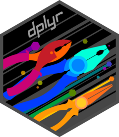{.imagen-derecha}

La actualización de `dplyr` agrega `filter_out()`, el complemento de `filter()`, los helpers `when_any()` y `when_all()`, y `recode_values()` y `replace_values()`. 

Además, `if_else()` y `case_when()` quedaron hasta 30 veces más rápidas.

[Blog](https://tidyverse.org/blog/2026/02/dplyr-1-2-0/) · [Sitio de dplyr](https://dplyr.tidyverse.org/)
:::

::: {.noticia}
**Paquetes de R chilenos: `territorial`**

{.imagen-derecha}

*Limpieza y validación de datos comunales, provinciales y regionales de Chile*

Si trabajas con datos que representen unidades territoriales de Chile, este paquete te ayudará con los nombres oficiales y códigos únicos de regiones, provincias y comunas. Incluye funciones para limpiar nombres de comunas, ayudar a su redacción, convertir entre nombres y códigos, e incluso un juego interactivo de preguntas.

[Sitio del paquete](https://bastianolea.github.io/territorial)
:::

::: {.noticia}
**data-dict**

{.imagen-derecha}

*Diccionarios de datos en YAML, validables y renderizables*

Es una herramienta de línea de comandos, no un paquete de R. `data-dict draft` perfila los datos y genera un borrador, `data-dict validate-data` comprueba que los datos cumplan el diccionario, y `data-dict render` produce una página HTML autocontenida. Incluye un skill para que agentes de IA redacten el diccionario. Hadley Wickham lo mostró en un Data Science Lab en junio, junto con [parquet](https://parquet.apache.org/) y [Claude Code](https://www.anthropic.com/claude-code).

[Quickstart](https://data-dict.tidyverse.org/quickstart.html)
:::

::: {.noticia}
**Paquetes de R chilenos: `poblador`**

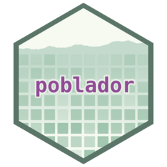{.imagen-derecha}

*Población oficial para cruzar con tus datos*

Entrega tablas de población de fuentes oficiales, como `censo_poblacion_2024`, y `agregar_poblacion()`, que infiere si tus datos son comunales, regionales o nacionales y funciona con nombres o códigos únicos territoriales. Depende de [territorial](https://github.com/bastianolea/territorial) y se instala desde [R-Universe](https://r-universe.dev/).

[Sitio del paquete](https://bastianolea.github.io/poblador)
:::

::: {.noticia}
**commons**

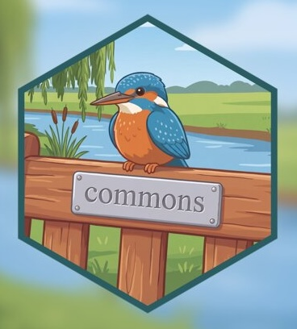{.imagen-derecha}

*Agentes de análisis de datos con "etiquetas de confianza"*

Es un paquete de R para construir agentes de análisis de datos confiables. Los agentes buscan primero en un conjunto de código confiable y, cuando una respuesta usa ese código, la marcan como verificada. Si no lo encuentran, escriben código nuevo respaldado por contexto verificado o dan una respuesta no confiable, y cada respuesta muestra de qué camino proviene. Está construido sobre [ellmer](https://ellmer.tidyverse.org/), [chatlas](https://posit-dev.github.io/chatlas/) y [shinychat](https://posit-dev.github.io/shinychat/r/).

[Anuncio](https://opensource.posit.co/blog/2026-09-15_commons-0-1-0/) · [Sitio](https://posit-dev.github.io/commons/) · [CRAN](https://cran.r-project.org/package=commons) · [GitHub](https://github.com/posit-dev/commons)
:::

::: {.noticia}
**webrarian 0.1.0: proyectos de R como sitios web**

{.imagen-derecha}

*Sesión de R personalizada en el navegador, sin servidor ni instalación*

[`webrarian`](https://coatless-wasm.github.io/webrarian/) empaqueta tus paquetes, scripts y datos en un sitio estático. Quien lo abre encuentra una sesión de R con editor, consola, explorador de archivos y panel de gráficos, todo listo. Como no hay servidor de cómputo, cualquier hosting estático sirve.

El paquete usa [webR](https://github.com/r-wasm/webr), la versión de R compilada a WebAssembly, y requiere R 4.4 o superior. Por ahora se instala desde GitHub con `pak::pak("coatless-wasm/webrarian")`. Según su autor, es útil para explorar un proyecto completo y para sitios que deban funcionar sin conexión.

[Sitio web del paquete](https://coatless-wasm.github.io/webrarian/) · [GitHub](https://github.com/coatless-wasm/webrarian) · [Anuncio](https://blog.thecoatlessprofessor.com/posts/introducing-webrarian/)
:::

## Comunidad

::: {.noticia}
**Posit Impact: Paulo Villarroel**

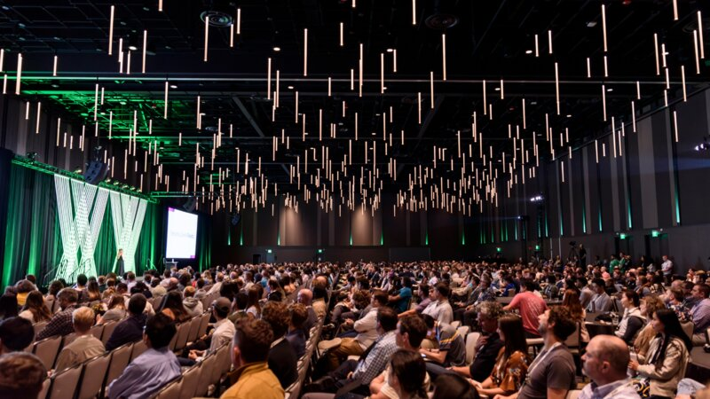{.imagen-derecha}

*Un chileno ganó en la categoría "Mission-Critical Impact"*

Paulo Villarroel Tapia, del [Ministerio de Salud de Chile](https://www.minsal.cl/), construyó con R, [Positron](https://positron.posit.co/) y [Quarto](https://quarto.org/) un sistema que cada mes lee unos 450.000 registros clínicos buscando sospecha de cáncer, con un clasificador de tres capas (heurísticas clínicas y embeddings semánticos). Alimenta a los 29 servicios de salud del país y fue la base del Plan Oncológico de 90 días. El modelo señala casos, pero la decisión clínica la toman los equipos locales.

[Artículo](https://posit.co/blog/2026-posit-impact-awards)
:::

::: {.noticia}
**HackeaR (LatinR 2026)**

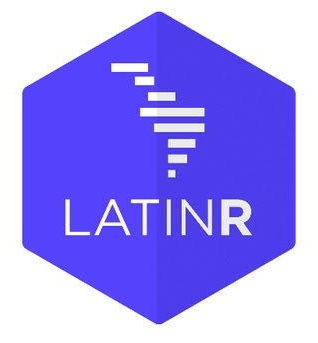{.imagen-derecha}

*Dos horas de contribuciones a R*

Fue el 13 de noviembre en Medellín, con 27 participantes y un tablero con 25 propuestas de trabajo en buenas prácticas, documentación y traducción. Aporta un dato práctico: no hace falta ser experto para contribuir a R.

[Crónica de rOpenSci](https://ropensci.org/es/blog/2026/11/20/hackear-latinr2026/) · [LatinR](https://latinr.org/)
:::

## Eventos

### Próximos

::: {.noticia}
**useR!2027 en Santiago de Chile**

{.imagen-derecha}

*Del 20 al 23 de julio de 2027, en el Centro de Extensión UC*

[useR!](https://user2027.r-project.org/) es la conferencia anual de la comunidad de R, sin fines de lucro y organizada por voluntarios con apoyo de la [R Foundation](https://www.r-project.org/foundation/). En 2027 llega por primera vez a Sudamérica, a Santiago, y coincide con la décima edición de [LatinR](https://latinr.org/). El llamado a propuestas abre el 15 de diciembre de 2026 y cierra el 30 de enero de 2027, y el registro abre el 15 de marzo. La sede es la Facultad de Matemáticas de la Pontificia Universidad Católica de Chile.

[Sitio de useR!2027](https://user2027.r-project.org/) · [Anuncio en LinkedIn](https://www.linkedin.com/posts/user-conf_user2027-rstats-datascience-activity-7480933120125353984-Cz2x)
:::

::: {.noticia}
**Hackatón RSE 2027**

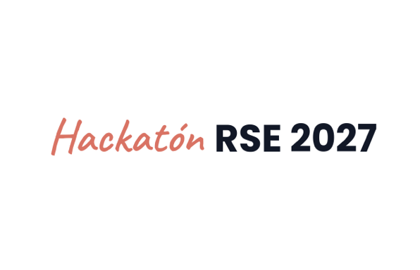{.imagen-derecha}

*Santiago de Chile, del 12 al 14 de enero de 2027, Campus San Joaquín (UC)*

Hackatón para conocer el trabajo de los ingenieros de software de investigación (RSE, por sus siglas en inglés), es decir, quienes desarrollan y mantienen el software que se usa en la investigación científica. Son mini-proyectos en grupo, dirigidos a estudiantes de postgrado, investigadores postdoctorales y personal técnico, con formación en ciencias, humanidades o ingeniería. 

[Las postulaciones cierran el viernes 4 de diciembre!](https://forms.gle/SjrnR4qqJLZsvU1P8)

[Sitio de la hackatón](https://charlas-rse-espanol.github.io/hackathon2027santiago/) · [Charlas RSE en español](https://charlas-rse-espanol.github.io/)
:::

### Pasados

::: {.noticia}
**Posit::conf 2026**

{.imagen-derecha}

Se presentaron [commons](https://posit-dev.github.io/commons/), Quarto Hub (edición colaborativa de proyectos Quarto) y los ocho ganadores de los [Posit Impact Awards](https://posit.co/blog/2026-posit-impact-awards).

[Takeaways de Positron](https://posit.co/blog/positron-at-posit-conf-2026)
:::

::: {.noticia}
**R+AI 2026**

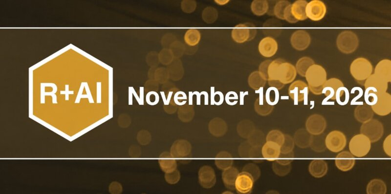{.imagen-derecha}

*Conferencia del [R Consortium](https://r-consortium.org/) sobre R e inteligencia artificial, 10 y 11 de noviembre, en línea*

Trató aprendizaje automático y modelos de lenguaje en R, herramientas de programación asistida por IA, despliegues en la industria e investigación en IA responsable. Las keynotes fueron de Andrew Heiss y Mine Çetinkaya-Rundel, y las charlas quedaron grabadas en el canal de YouTube del R Consortium.

[Sitio de R+AI 2026](https://rconsortium.github.io/RplusAI_website/)
:::

::: {.noticia}
**[V Congreso y XVI Jornadas de Usuarios de R (Tenerife)](https://eventos.ull.es/152998/detail/v-congreso-y-xvi-jornadas-de-usuarios-de-r-2026.html)**

{.imagen-derecha}

*Entre el 25 y el 27 de noviembre*

El congreso reúne en San Cristóbal de La Laguna, en el Campus de Anchieta de la Universidad de La Laguna, a la comunidad hispanohablante que usa R para análisis de datos, investigación e innovación. Incluye ponencias, talleres, sesiones paralelas y espacios de networking. La jornada del miércoles 25 tiene talleres divulgativos y la sesión inaugural, mientras que el jueves y el viernes se reparten ponencias plenarias, comunicaciones y talleres.

La inscripción presencial, con cupo limitado a 100 plazas, estuvo abierta hasta el 9 de noviembre, con precios especiales para estudiantes y miembros de R Hispano. También hubo un concurso de abstracts con premios al mejor trabajo, al mejor de un autor menor de 30 años y al mejor con datos de Canarias.

[Sitio del evento](https://eventos.ull.es/152998/detail/v-congreso-y-xvi-jornadas-de-usuarios-de-r-2026.html) · [Comunidad R Hispano en X](https://x.com/R_Hisp)
:::

::: {.noticia}
**LatinR 2026**

{.imagen-derecha}

*La novena edición volvió a ser presencial, en Medellín*

La conferencia latinoamericana sobre uso de R en I+D se realizó del 11 al 13 de noviembre en la Universidad de Antioquia, Medellín, Colombia. Fue la primera edición presencial desde 2023, tras las versiones virtuales de 2024 y 2025. El programa incluyó tutoriales, charlas y sesiones de diálogo con presentadores, con temas como aplicaciones en academia e industria, machine learning e inteligencia artificial, visualización y investigación reproducible. Las charlas se presentaron en español, portugués e inglés.

[Sitio de LatinR](https://latinr.org/) · [Programa detallado](https://latinr.org/cronograma/programa/detallado.html)
:::
